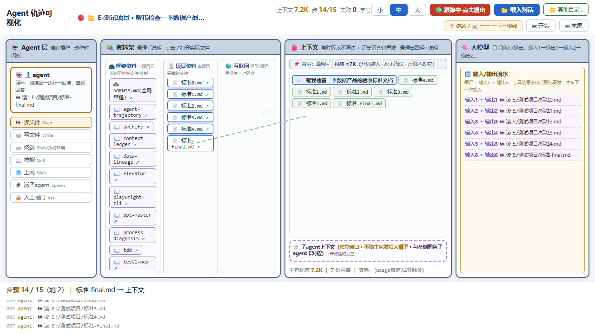

# Agent Trajectory 可视化回放

把 [pi](https://github.com/badlogic/pi-mono)（终端 coding agent）的会话日志解析成**可视化轨迹回放页**：看清一个对话里 agent 动了哪些资料、跑了什么命令、上下文怎么被装满、压缩、又怎么继续。

> English one-liner: Parse pi coding-agent session logs into an explorable, step-by-step visual replay — agent actions, context packing, compaction and tool loops, all in one zero-dependency HTML page.



## 它回答什么问题

- 这个对话里 **agent 到底干了什么**？（读写了哪些文件、跑了什么命令、上了什么网）
- **上下文是怎么被填满的**？每一份资料装包多少、什么时候触顶压缩
- 哪里在**打转**、哪里**失败集中**、哪里**烧 token**
- 培训演示：**聊天 vs agent** 的区别在哪（模型的每一步都被 harness 执行并回填）

## 四区结构


滚轮/方向键一步一根线；14 类动作 schema：`boot / user_msg / answer / think / read / write / exec / web / skill / spawn / report / ask / compress / inject`。

## 快速开始

```bash
# 1. 建库（扫描 ~/.pi/agent/sessions/ 全量会话 → lib/）
python -X utf8 build_library.py

# 2. 回放（零依赖零 fetch，双击即可）
agent-trajectory-replay.html
```

实时跟踪正在进行的对话：

```bash
python -X utf8 live_server.py      # http://localhost:8765 → 🔴 跟踪
```

对 pi 说「轨迹回放 / 看看我的对话运行情况」可直接调用（skill 目录拷到 `~/.agents/skills/agent-trajectory/`）。

服务运行期间新开的对话：对话清单点「🔄 刷新」即可载入（🆕 组实时解析，转正的临时会话也会出现在这里）。

## 特性

- **逐步回放**：一条线 = 一次「资料 → 资料」流动；agent 层闪一下表示操作方
- **上下文装包可视化**：条目悬停看详情与装包量，点击画线溯源到资料架原件
- **压缩可视化**：触顶自动 / 手动 compact_context，历史条目塌缩、🗜 摘要入堆
- **真实计量**：usage 真值（输入/输出/思考/成本）优先于估算
- **字号三档**：小看全局架构、大看文件细节（连线自动对位）
- **实时跟踪**：正在写入的对话，视角钉在末尾自动跟上节奏（红点脉冲动效）
- **新会话刷新载入**：清单内 🔄 一键合并服务运行期新增会话
- **harness 注入建模**：🧷系统提醒 / 📎用户装料 / ✂️手动剪除——上下文不全是模型自取的

## 架构

```
pi 会话 JSONL ──parse_pi_session.py──▶ 14动作事件流 ──build_library.py──▶ lib/(索引+分片)
                                                            │
                                    agent-trajectory-replay.html（纯前端回放）
                                    live_server.py（增量解析+实时跟踪）
```

解析层与渲染层解耦：换任何 agent 工具链只需改 `parse_pi_session.py` 里的 `TOOL_MAP`。

## 前提与限制

- python 3.8+（仅标准库）；会话日志在 `~/.pi/agent/sessions/`
- `tokens`：条目「装包」为字符估算，统计条「真耗」为 usage 真值（含缓存重发），报告时注意口径
- 子 agent 只显发起/回包，内部轨迹不下钻（规划中）
- Claude Code / Codex 格式未接入（schema 已预留 think/inject 位）

## 更新日志

完整变更见 [CHANGELOG.md](CHANGELOG.md)。当前版本 **v1.1.0**（2026-10-09）：
新增对话清单 🔄 刷新载入新会话、时间倒序排序；修复字号切换浮窗偏离、http 下文件打开失效；跟踪红点动效、滚动条减细。

<details>
<summary>历史版本</summary>

**v1.0.0**（2026-10-08）：首个公开版本——四区结构回放、14 动作 schema、压缩与装包可视化、实时跟踪、字号三档、skill 化。

</details>

## License

MIT
